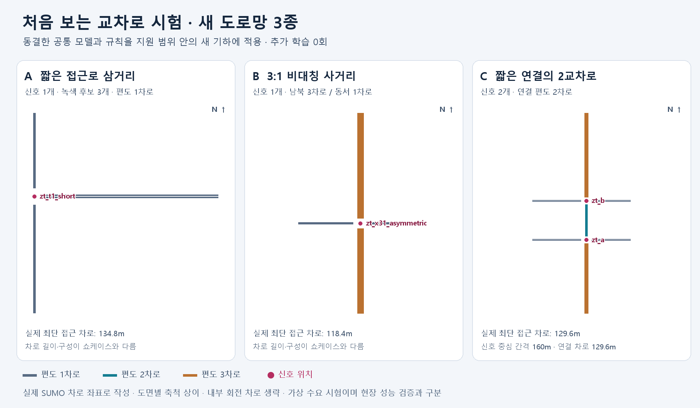

# 새 교차로 동결 모델 적용 — 비교 결과

최종 확인일: 2026-10-29 / 시험 기준 동결: 2026-10-28. 도로망 제작·호환·평가 준비·별도 검토와 예정162개 비교의 시도 및 원시 검증을 마쳤다. 완료157회, 실패5회, 미시도0회다.

**추가 학습·모델/규칙/수요 변경·실패 재시도는 모두0회다.** 기존 seed43/V2/wait35를 그대로 사용했다.

## 제작과 호환성

| 도로망 | 쇼케이스와의 실질적 차이 | 확인 |
|---|---|---|
| 짧은 접근로 삼거리 | 삼거리·편도1차로·비대칭 접근 길이 | 신호1개/녹색3후보·실제 최단 접근134.8m |
| 3:1 비대칭 사거리 | 남북3/동서1차로·비대칭 길이 | 신호1개/녹색4후보·실제 최단 접근118.4m |
| 짧은 연결2교차로 | 신호2개·중심 간격160m·연결 편도2차로 | 각4후보·양방향 연결 차로129.6m |

27개 명시적 수요의0초 로드, 보호 신호/공유 차로/전 차로 서비스, OD·차종 접근을 확인했다. 별도600초 기능 검사3회에서144/144대가 도착했고 충돌·teleport·경고0이었다. 모든 녹색 후보를 실제 관찰하고 매초 관측·신호·차량 지표를 독립 재계산했다.

## 실패와 시험 해석

원래 본 배치는127회 완료 후128번째 연결 구간 혼잡 Webster에서 버스의300초 연속 대기/yield teleport로 중단했다. 실패 운행은504초 관측까지 기록했으며900초 완료 지표로 취급하지 않았다.

별도 중단 검토 후 미시도34회만 별도 후속 폴더에 수집했다. 각 후속 배치도 오류·충돌·teleport·기록 불일치 시 전체 중단하고 재검토했다. 원래 실패 배치·원시 기록·이전 검증기 버전을 모두 보존했다.

**원래27조건 전체의 사전 주 목표 통과를 주장할 수 없다.** 아래는 중단 후 별도 수집까지 포함한 서술적 비교이며, 실패를 뺀 숫자만으로 원래 시험을 성공으로 바꾸지 않는다. 제어별 완료 조건 수와 비교에 사용한 짝의 수를 함께 적었다.

| 제어 | 900초 완료 | 실패 | 완료 운행의 경고 수 |
|---|---:|---:|---:|
| Fixed | 27/27 | 0 | 0 |
| Webster | 22/27 | 5 | 0 |
| Max-Pressure | 27/27 | 0 | 0 |
| SmartSignal V2 | 27/27 | 0 | 0 |
| 학습 모델 단독 | 27/27 | 0 | 0 |
| 규칙 중심 진단 | 27/27 | 0 | 0 |

실패 목록:

- `zt_pair_short_busy_s00/webster`: failed_teleport, 관측504초, 충돌0/teleport1. 신호·관측·정책 prefix 재생 PASS.
- `zt_pair_short_busy_s01/webster`: failed_teleport, 관측621초, 충돌0/teleport1. 신호·관측·정책 prefix 재생 PASS.
- `zt_pair_short_busy_s02/webster`: failed_teleport, 관측478초, 충돌0/teleport1. 신호·관측·정책 prefix 재생 PASS.
- `zt_pair_short_directional_s00/webster`: failed_teleport, 관측481초, 충돌0/teleport1. 신호·관측·정책 prefix 재생 PASS.
- `zt_pair_short_directional_s02/webster`: failed_teleport, 관측762초, 충돌0/teleport1. 신호·관측·정책 prefix 재생 PASS.

첫 실패는 경로의 연결 차로가 연속이며 필수 차로 변경도 없었다. 연결 차로 혼잡과 상·하류 녹색 시점의 불일치에 부합하지만 정확한 양보 간격·선행차 원인은 위치/간격 자료가 없어 미확정이다. [진단](teleport-diagnosis.json), [중단 검토](teleport-review-01.md), [SUMO teleport 설명](https://sumo.dlr.de/docs/Simulation/Why_Vehicles_are_teleporting.html).

## 동일 조건끼리의 SmartSignal 비교

각 행은 SmartSignal과 해당 비교 제어가 모두900초 완료한 조건만 짝지었다. 조건 수가 다른 행의 평균은 서로 다른 표본이므로 전체27조건의 동일 평균으로 간주하지 않는다. 변화율은 음수일수록 대기행렬이 작다.

| 비교 제어 | 완료 짝 수 | Smart 평균 대기행렬(대) | 비교 평균(대) | Smart 변화율 | 도착 수 Smart / 비교 |
|---|---:|---:|---:|---:|---:|
| Fixed | 27 | 32.273 | 39.859 | -19.03% | 8709 / 8356 |
| Webster | 22 | 17.519 | 21.919 | -20.07% | 6071 / 5938 |
| Max-Pressure | 27 | 32.273 | 31.483 | +2.51% | 8709 / 8387 |
| 학습 모델 단독 | 27 | 32.273 | 33.807 | -4.54% | 8709 / 8660 |
| 규칙 중심 진단 | 27 | 32.273 | 31.452 | +2.61% | 8709 / 8388 |

학습 기여 사전 목표(규칙 진단 대비 대기행렬2% 이상 감소·도착 비감소)는 완료 짝에서 **미충족**이다. 학습 점수를 호출하거나 새 도로망에서 실행된 사실만으로 학습의 성능 기여를 입증했다고 하지 않는다.

Fixed 대비 개별 대기행렬 악화는 공통 완료27조건 중0조건이다. 최악 조건:

- `zt_x31_asymmetric_busy_s02`: Smart 48.101대 / Fixed 49.093대, -2.02%.
- `zt_t1_short_busy_s02`: Smart 4.192대 / Fixed 4.541대, -7.68%.
- `zt_pair_short_busy_s01`: Smart 97.232대 / Fixed 106.502대, -8.70%.

## 6제어가 모두 완료한 조건의 구간별 결과

이 표는 공통 완료22조건만 사용한다. 중단 때문에 제외된 어려운 조건이 있어 원래 전체 목표의 판정 자료로 대체하지 않는다.

| 도로망 | 공통 완료 조건 | Smart 대기행렬(대) | Fixed 대비 | Webster 대비 | Max-Pressure 대비 |
|---|---:|---:|---:|---:|---:|
| `zt_pair_short` | 4/9 | 25.146 | -31.26% | -31.71% | -7.63% |
| `zt_t1_short` | 9/9 | 3.107 | -43.85% | -31.47% | -19.38% |
| `zt_x31_asymmetric` | 9/9 | 28.542 | -19.38% | -12.66% | +9.65% |

## 수요 표본 간 변동

각 칸은 해당 도로망·수요의 Smart/Fixed 공통 완료 표본이다. 변화율은 표본별 비율의 평균±표본 표준편차이며, 위의 전체 평균 비율과 계산 단위가 다르다. 최대3개 표본의 서술 통계로 신뢰구간/유의성이나 학습 초기값 반복을 주장하지 않는다.

| 도로망 | 수요 | 완료 짝 / 예정3 | Fixed 대비 변화율 평균 ± SD | 표본 최소~최대 | 도착 수 Smart / Fixed |
|---|---|---:|---:|---:|---:|
| `zt_pair_short` | busy | 3/3 | -10.23% ± 1.56%p | -11.81% ~ -8.70% | 1646 / 1493 |
| `zt_pair_short` | directional | 3/3 | -24.08% ± 12.58%p | -34.71% ~ -10.18% | 1474 / 1343 |
| `zt_pair_short` | quiet | 3/3 | -26.90% ± 6.45%p | -33.75% ~ -20.93% | 901 / 901 |
| `zt_t1_short` | busy | 3/3 | -27.49% ± 17.24%p | -39.09% ~ -7.68% | 525 / 525 |
| `zt_t1_short` | directional | 3/3 | -54.82% ± 11.67%p | -61.92% ~ -41.35% | 449 / 449 |
| `zt_t1_short` | quiet | 3/3 | -39.69% ± 7.29%p | -48.08% ~ -34.88% | 263 / 263 |
| `zt_x31_asymmetric` | busy | 3/3 | -13.54% ± 12.88%p | -27.45% ~ -2.02% | 1493 / 1455 |
| `zt_x31_asymmetric` | directional | 3/3 | -22.93% ± 10.29%p | -34.62% ~ -15.28% | 1245 / 1214 |
| `zt_x31_asymmetric` | quiet | 3/3 | -26.57% ± 6.53%p | -32.04% ~ -19.33% | 713 / 713 |

## 실행 근거와 재현

- 실제 교통 시도: 기능3회 + 예비12회 + 비교162회 = 177회. 0초 로드27회는 교통 운행과 구분한다.
- 새 기능9검사·기존 이력 감사9검사·후속 보호5검사를 통과했다. 기능/예비/완료 비교의 독립 재생과 원시 파일 SHA를 확인했다. 실패 운행은 별도 prefix 검사로 기록한다.
- 예비8번째 Webster 검증기의 수치 경계 불일치를 수정했으며 원래8개 운행의 기록/생산 소스를 유지한 재감사만 수행했다. 이 오류를 통과로 덮어쓰거나 교통을 재운행하지 않았다.
- 실행 환경: Python3.12.14 / NumPy2.3.5 / SUMO1.26.0. 원래17개 기준 소스와 모델/정책 해시는 유지했다.
- Smart 실행 분기 집계: `{'low_pressure': 2442, 'ai_queue_guard': 4038}`. 분기 이름은 진단 정보이며 학습 효과의 비율이나 인과 추정으로 해석하지 않는다.
- 가상 수요·지원된 T/X·1~3차로의 새 기하에 대한 결과다. 미지원 교차로/실제 현장/모든 조건의 우수성을 주장하지 않는다.

이력 대조는 확인 가능한 모델 메타데이터·입력·문서 근거를 사용했다. 과거 원시 근거5개는 이 컴퓨터에 없으므로 모든 과거 운행을 재감사했다는 주장은 하지 않는다. 새 입력의 중복 제외·고정 해시와 실제 이번 원시 검증은 별도로 남겼다.

[제작·검사·실행 명령](execution.md), [별도 평가 검토](evaluation-review.md), [동결 명세](protocol.json).

[기계 판독 결과](../../results/runs/unseen_transfer_20261028/reviewed-followup-summary.json), [모든162시도 CSV](../../results/runs/unseen_transfer_20261028/reviewed-followup-comparison.csv).

재현 확인은 번들 Python의 `-X utf8 -B`로 `tools/audit_unseen_transfer.py verify`와 마지막 후속 번호의 `tools/report_unseen_transfer.py --verify --round N`을 사용한다. 후자는 원시/부모 배치·검토·소스 SHA와 모든162행, 짝별 평균·변화율·도착 수를 읽기 전용으로 재검증한다. 운행 명령은 기존 출력 경로에 재실행하지 않는다.

다음 연구 작업은 처리량과 대기행렬의 상충·실패 상황을 바탕으로 별도 개발 환경에서 개선 가설을 정하는 것이다. 이 시험에서 본 결과로 규칙을 바꾸고 같은 표본을 다시 미사용 최종 시험으로 주장하지 않는다.
